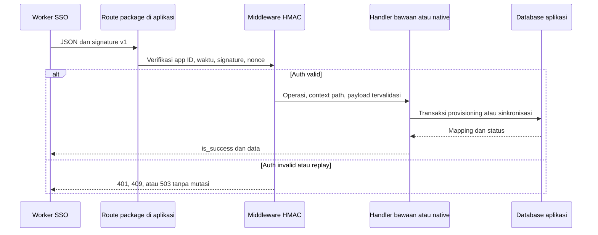

# Integrasi aplikasi internal melalui package

Modul ini menyediakan 12 route provisioning di server aplikasi Laravel yang memasang package. Route **nonaktif secara default** dan terpisah dari middleware login legacy dan OAuth scope. Package tidak menjalankan server pusat sendiri.

## Instalasi dan konfigurasi

Setelah memasang versi package yang memuat modul ini:

```bash
composer require keloola/keloola-sso-authorize
php artisan vendor:publish --tag=keloola-auth-config
```

Jika file `config/keloolauthorize.php` sudah ada, gabungkan bagian `integration` dari config package secara manual. Jangan menimpa konfigurasi lama dengan `--force` tanpa meninjau isinya.

```dotenv
KELOOLA_AUTH_APP_ID=123
KELOOLA_AUTH_SSO_HOST=https://accounts.example.com
KELOOLA_SSO_INTEGRATION_ENABLED=true
KELOOLA_SSO_INTEGRATION_SECRET=<secret acak minimal 32 karakter, khusus aplikasi ini>
KELOOLA_SSO_INTEGRATION_CACHE_STORE=redis
```

SSO dan aplikasi memegang secret yang sama. Jangan taruh secret di `VITE_*`, browser, source control, atau log. Pakai HTTPS di production. Gunakan cache dengan atomic `add` dan penyimpanan bersama untuk semua instance aplikasi (misalnya Redis). Cache `array`/`null` ditolak di luar environment testing. Cache tidak tersedia menghasilkan `503`; request tidak diteruskan ke handler.

Tambahkan katalog permission dengan ID numerik stabil pada config:

```php
'integration' => [
    'enabled' => env('KELOOLA_SSO_INTEGRATION_ENABLED', false),
    'prefix' => 'api/integrations/sso',
    'secret' => env('KELOOLA_SSO_INTEGRATION_SECRET'),
    'clock_skew_seconds' => 300,
    'cache_store' => env('KELOOLA_SSO_INTEGRATION_CACHE_STORE'),
    'handler' => \Keloola\KeloolaSsoAuthorize\Integration\DatabaseIntegrationHandler::class,
    'permissions' => [
        ['id' => 101, 'name' => 'inventory.read', 'group' => 'inventory', 'guard_name' => 'web'],
        ['id' => 102, 'name' => 'inventory.update', 'group' => 'inventory', 'guard_name' => 'web'],
    ],
],
```

Untuk handler database bawaan:

```bash
php artisan vendor:publish --tag=keloola-integration-migrations
php artisan migrate
php artisan optimize:clear
php artisan route:list --name=keloola.integration
```

Rebuild config/route cache sesuai proses deployment setelah konfigurasi final. Route tidak memakai grup `web`, cookie, atau CSRF; autentikasinya adalah signature server. Middleware global aplikasi tetap berlaku: jangan memasang middleware login yang mewajibkan subscription aktif pada semua request provisioning. Pilih middleware bisnis pada route bisnis saja.

## Katalog permission dari Spatie

Secara default, `integration.permission_source` bernilai `array` dan memakai `integration.permissions` seperti sebelumnya. Untuk aplikasi yang sudah memasang `spatie/laravel-permission`, gabungkan pengaturan berikut ke `config/keloolauthorize.php`:

```php
'permission_source' => env('KELOOLA_SSO_PERMISSION_SOURCE', 'array'),
'spatie' => [
    'guard_name' => env('KELOOLA_SSO_PERMISSION_GUARD', 'web'),
    'group_attribute' => null,
],
```

Lalu set environment aplikasi:

```dotenv
KELOOLA_SSO_PERMISSION_SOURCE=spatie
KELOOLA_SSO_PERMISSION_GUARD=web
```

Bangun ulang config cache sesuai deployment. Model dibaca dari `config('permission.models.permission')`, sehingga custom model Spatie juga didukung. Package ini tidak memasang Spatie atau menjalankan migration Spatie secara otomatis. Model/tabel harus siap sebelum integrasi dipanggil.

`GET /api/integrations/sso/permissions` tetap menghasilkan:

```json
{
  "is_success": true,
  "data": [
    {"id": 101, "name": "inventory.read", "group": "general", "guard_name": "web"}
  ]
}
```

ID berasal dari primary key permission Spatie dan harus integer positif; UUID tidak didukung oleh kontrak SSO ini. Katalog hanya memuat guard yang dipilih, diurutkan berdasarkan ID, tanpa pagination. Kolom internal lain pada model tidak diekspos. Spatie standar tidak memiliki field `group`; default respons adalah `general`. Jika custom model memiliki kolom/accessor kategori, set `group_attribute` ke nama atribut tersebut, misalnya `group` atau `category`. Nilai null menggunakan fallback `general`.

Sumber yang dipilih dipakai bersama oleh endpoint katalog, validasi create/update role, permission owner saat provisioning pertama, dan `DirectoryAccess`. Mode Spatie tidak menggabungkan array config. Konfigurasi/model/tabel tidak valid menghasilkan `503 integration_unavailable` tanpa fallback diam-diam. Data dibaca saat operasi berjalan; penambahan permission tidak otomatis memperluas role lama.

**Cakupan:** ini memilih sumber katalog permission. Role/membership handler bawaan tetap berada di direktori `keloola_sso_*`; fitur ini tidak otomatis mengubah pivot role/user Spatie. Gunakan handler native jika aplikasi memerlukan sinkronisasi role/anggota Spatie. Adapter yang sebelumnya membaca array config perlu memakai `app(\Keloola\KeloolaSsoAuthorize\Integration\PermissionCatalog::class)->all()` agar memakai sumber yang sama.

Sebelum berpindah dari array ke Spatie pada aplikasi yang sudah terpasang, samakan mapping ID permission lama dengan ID Spatie atau lakukan migrasi mapping yang ditinjau. Jangan sekadar mengganti sumber jika ID berbeda: role direktori dan mapping SSO menyimpan ID tersebut. Uji ulang katalog, role, dan akses setelah migrasi.

## Dua cara menggunakan penyimpanan

**Handler bawaan:** membuat direktori integrasi pada tabel `keloola_sso_organizations`, `keloola_sso_users`, `keloola_sso_memberships`, `keloola_sso_roles`, dan `keloola_sso_invitations`. Organisasi/user memakai UUID SSO sebagai primary key; ID role berupa integer lokal. Tidak ada password SSO yang disimpan. Aplikasi baru dapat memakai direktori ini sebagai sumber membership dan role; tabel bisnis tetap harus dibatasi per organisasi.

**Handler khusus:** untuk aplikasi yang sudah mempunyai `users`, `companies`, team, Spatie roles, bucket, atau proses provisioning khusus, implementasikan `IntegrationHandler` lalu ganti konfigurasi `integration.handler`. Package tetap menangani route, HMAC, validasi input, dan envelope respons. Migration direktori tidak wajib jika handler khusus tidak memakainya.

```php
use Keloola\KeloolaSsoAuthorize\Integration\IntegrationHandler;
use Keloola\KeloolaSsoAuthorize\Integration\IntegrationException;

class NativeIntegrationHandler implements IntegrationHandler
{
    public function __construct(private AppProvisioningService $service) {}

    public function handle(string $operation, array $context, array $payload): array
    {
        // AppProvisioningService adalah service bisnis milik aplikasi.
        // Implementasikan operasi yang digunakan; jangan mengembalikan sukses
        // sebelum tenant/membership native benar-benar siap.
        return match ($operation) {
            'organizations.provision' => $this->service->provision($payload),
            'members.store' => $this->service->addMember($context['organizationId'], $payload),
            default => throw new IntegrationException('unsupported_operation', 'Operation is not configured.', 501),
        };
    }
}
```

Contoh handler tersebut adalah template, bukan adapter siap pakai untuk schema aplikasi tertentu. Handler harus mengembalikan array `data` sesuai kontrak dan memakai transaksi, mapping ID, pemeriksaan tenant, serta idempotensi. `IntegrationException` menghasilkan error JSON; exception tak terduga mengikuti exception handler Laravel aplikasi. Payload yang diterima sudah divalidasi dan field tambahan yang tidak dikenal tidak diteruskan, termasuk field tambahan dalam `owner`.

**Batas mode bawaan:** provisioning tidak membuat record di tabel native aplikasi, tidak melakukan `Auth::login`, tidak membuat bucket/COA, dan tidak menghapus sesi native saat membership dihapus. `ready` berarti direktori package siap. Jika native tenant diperlukan sebelum login, gunakan handler khusus yang memastikan native tenant siap sebelum mengembalikan `ready`.

## Endpoint, payload, dan operasi handler

Prefix default: `/api/integrations/sso`. Semua request dengan body harus JSON object. `{organizationId}`/`{userId}` adalah UUID SSO; `{roleId}` adalah integer role lokal aplikasi. `{invitationId}` string ID undangan SSO. Seluruh sukses memakai HTTP `200` dengan `{"is_success":true,"data":...}`. DELETE idempotent juga mengembalikan JSON.

| Method dan path relatif | Operasi handler | Payload |
| --- | --- | --- |
| POST `organizations` | `organizations.provision` | `sso_organization_id`, `organization_name`, `owner: {sso_id, name, email}` wajib; `organization_email` opsional/nullable |
| PATCH `organizations/{organizationId}` | `organizations.update` | Minimal satu dari `name`, `email`, `address`; name tidak nullable, email/address nullable |
| POST `organizations/{organizationId}/members` | `members.store` | `sso_id`, `name`, `email`, `role_id` wajib |
| PUT `organizations/{organizationId}/members/{userId}/role` | `members.role` | `role_id` wajib |
| DELETE `organizations/{organizationId}/members/{userId}` | `members.destroy` | Tanpa body |
| GET `permissions` | `permissions.index` | Tanpa body; katalog lengkap dari konfigurasi |
| GET `organizations/{organizationId}/roles` | `roles.index` | Tanpa body; seluruh role organisasi |
| POST `organizations/{organizationId}/roles` | `roles.store` | `sso_role_id`, `name`, `permissions` wajib; description opsional/nullable |
| PUT `organizations/{organizationId}/roles/{roleId}` | `roles.update` | `name`, `permissions` wajib; description opsional/nullable |
| DELETE `organizations/{organizationId}/roles/{roleId}` | `roles.destroy` | Tanpa body |
| POST `invitations` | `invitations.store` | `sso_invitation_id`, `sso_organization_id`, `email`, `role_id`, `expires_at` wajib |
| DELETE `invitations/{invitationId}` | `invitations.destroy` | Tanpa body |

Lihat [OpenAPI](integration.openapi.json) untuk tipe, batas panjang, respons, dan contoh. Tidak ada pagination. Permission ID yang dikirim harus ada dalam katalog. Array `permissions: []` valid dan menghapus seluruh permission role. `sso_role_id` adalah ID record role di SSO dalam bentuk string, bukan ID role aplikasi; SSO menyimpan ID role aplikasi dari respons sebagai `source_role_id`.

Contoh provisioning:

```json
{
  "sso_organization_id": "11111111-1111-4111-8111-111111111111",
  "organization_name": "PT Contoh",
  "organization_email": "office@example.com",
  "owner": {
    "sso_id": "22222222-2222-4222-8222-222222222222",
    "name": "User Contoh",
    "email": "user@example.com"
  }
}
```

Respons handler bawaan:

```json
{
  "is_success": true,
  "data": {
    "organization_id": "11111111-1111-4111-8111-111111111111",
    "sso_organization_id": "11111111-1111-4111-8111-111111111111",
    "owner_user_id": "22222222-2222-4222-8222-222222222222",
    "owner_role_id": 1,
    "status": "ready"
  }
}
```

Role Admin awal mengambil permission yang tersedia saat provisioning pertama. Menambah katalog permission tidak otomatis menambahkan permission itu ke role yang sudah ada; rencanakan perubahan permission role lewat handler/migrasi yang ditinjau. Role owner bawaan dilindungi dari edit/delete dan tidak dapat diberikan ke anggota lain.

## Idempotensi, urutan event, dan batas retry

- Registrasi organisasi berulang dengan owner sama mempertahankan tenant dan role; owner berbeda menghasilkan `409`. Perubahan nama/alamat menggunakan PATCH agar retry instalasi lama tidak menimpa pembaruan organisasi.
- Pembuatan role memakai pasangan organisasi + `sso_role_id`. Retry identik mengembalikan ID sama; isi berbeda `409`. Update role melalui PUT.
- Penambahan membership identik aman diulang; role berbeda pada membership aktif menghasilkan `409`. Perubahan role melalui endpoint khusus.
- Penghapusan membership hanya berlaku dalam satu organisasi. User dan membership tenant lain tetap ada. Owner tidak dapat dihapus/diganti role.
- Role yang masih dipakai anggota/undangan pending atau dilindungi tidak dapat dihapus. DELETE role tidak ada sukses; ID role milik tenant lain tidak pernah diubah.
- Mirror undangan tidak memberi akses. Pembatalan menyimpan tombstone sehingga create terlambat tidak mengaktifkannya kembali. Mirror untuk anggota yang sudah aktif ditandai accepted. DELETE mirror accepted tidak menghapus membership.
- `expires_at` memakai UTC `YYYY-MM-DDTHH:MM:SSZ`. Undangan yang sudah expired saat diterima tidak menjadi pending. Package tidak menjalankan scheduler expiry; SSO perlu mengirim pembatalan saat undangan kedaluwarsa. Undangan pending tidak memberi akses walaupun scheduler tertunda.
- Package belum mempunyai event-version/outbox lintas sistem. Urutkan perubahan per user/organisasi; jangan mengulang event add-member lama setelah ada remove-member yang lebih baru, karena itu bisa membuat membership lagi. Setelah timeout, rekonsiliasi state terakhir di SSO sebelum retry. Gunakan nonce baru untuk setiap percobaan HTTP.

## Autentikasi HMAC v1

Header wajib: `X-Keloola-Timestamp` (Unix detik), `X-Keloola-App-Id` (`apps.id`), `X-Keloola-Nonce` (16–128 karakter alfanumerik, `_` atau `-`), dan `X-Keloola-Signature`.

```text
canonical = timestamp + "\n" + UPPERCASE_METHOD + "\n"
          + raw_path + "\n" + raw_query + "\n" + raw_body + "\n"
          + app_id + "\n" + nonce
signature = "sha256=" + hex(HMAC-SHA256(canonical, secret))
```

Tidak ada newline tambahan di akhir. Raw query tidak boleh diurutkan ulang; raw body harus sama persis dengan byte JSON yang dikirim. Path mencakup prefix deployment jika ada. Jam server perlu sinkron; toleransi default 300 detik. Nonce disimpan selama dua kali toleransi ditambah satu detik. Reverse proxy tidak boleh mengubah path/query/body yang ditandatangani tanpa penyesuaian kontrak.

**Ini berbeda dari HMAC Projects legacy:** v1 package menambahkan app ID dan nonce untuk membatasi target aplikasi dan menolak replay. Jangan memakai `ProjectService` lama tanpa memperbarui penandatanganannya. Bearer user/cookie login tidak diterima sebagai pengganti signature pada endpoint provisioning.

## Client untuk backend SSO

Package menyediakan `IntegrationClient` untuk Laravel. Pasang versi package yang sama di pemanggil, simpan konfigurasi aplikasi di server SSO, kemudian gunakan:

```php
use Keloola\KeloolaSsoAuthorize\Integration\IntegrationClient;

$client = new IntegrationClient(
    baseUrl: config('services.inventory.base_url'),
    secret: config('services.inventory.integration_secret'),
    appId: (string) $app->id,
);

$result = $client->send('POST', 'organizations', [
    'sso_organization_id' => $organization->id,
    'organization_name' => $organization->name,
    'organization_email' => $organization->email,
    'owner' => [
        'sso_id' => $organization->owner->id,
        'name' => $organization->owner->name,
        'email' => $organization->owner->email,
    ],
]);
// Adapter harus mengecek result.status == ready, ID organisasi yang sesuai,
// dan menyimpan source_role_id sebelum mengaktifkan subscription.
```

Client menandatangani raw body, memakai timeout 15 detik/connect timeout 5 detik, tidak mengikuti redirect, dan tidak otomatis retry. HTTP error atau envelope sukses tidak valid melempar `IntegrationException`; status HTTP error tersedia di `$exception->status`. Gangguan transport melempar exception HTTP Laravel. Pakai `rawurlencode` untuk ID string pada segmen path, dan jangan memasukkan query/body untuk GET/DELETE melalui client ini.

Pemasangan package **tidak otomatis menyambungkan job SSO**. Job instalasi, undangan, perubahan role/anggota, dan sinkronisasi organisasi perlu memanggil client ini serta menyimpan mapping respons. Paket ini tidak mengubah repositori/deployment SSO, tidak membuat OAuth client, dan tidak menerapkan quota; endpoint quota tetap disediakan package `keloola/quota` bila dibutuhkan.

## Memeriksa akses lokal

Setelah memperoleh identitas dan organisasi terverifikasi dari middleware SSO, aplikasi yang memakai direktori bawaan dapat memeriksa permission lokal:

```php
use Keloola\KeloolaSsoAuthorize\Integration\DirectoryAccess;

$allowed = app(DirectoryAccess::class)->allows($verifiedOrganizationId, $verifiedUserId, 'inventory.read');
abort_unless($allowed, 403);
```

Helper tidak melakukan login/verifikasi token atau mengecek subscription. ID harus berasal dari konteks autentikasi terverifikasi, bukan body/query pengguna. Tetap periksa subscription dan batasi query bisnis pada organisasi yang sama. Helper membaca membership/role terbaru dari database, sehingga penghapusan membership langsung menolak pemeriksaan berikutnya tanpa cache lokal. Jika memakai handler native, gunakan policy/permission native aplikasi.

## Diagram



## Error dan pengujian

| HTTP | Makna |
| --- | --- |
| 401 | Signature, target app, nonce format, atau timestamp tidak valid |
| 404 | Modul nonaktif, organisasi/membership/role tidak ditemukan dalam tenant |
| 409 | Replay, konflik mapping, owner dilindungi, atau role masih digunakan |
| 422 | JSON/payload/permission tidak valid |
| 501 | Handler khusus tidak mendukung operasi |
| 503 | Secret/cache/katalog konfigurasi tidak siap |

```bash
composer test
```

Suite mencakup auth, replay, validasi, transaksi rollback, provisioning idempotent, isolasi tenant, role/anggota, mirror undangan, custom handler, dan regresi middleware scope. Pengujian lokal memakai Testbench/SQLite; belum membuktikan deployment multi-instance, transport production, migrasi pada database aplikasi nyata, atau handler bisnis khusus.
